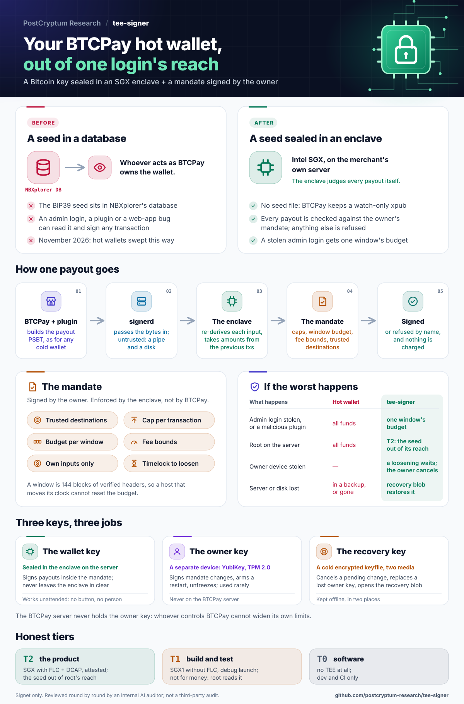

# tee-signer

**Sealed in the enclave. Never a file. Signs only what the owner allows.**

A BTCPay Server hot wallet without a hot seed. The key is generated inside an Intel SGX enclave on the
merchant's own server and never leaves it in clear. The enclave judges every payout against a mandate the merchant
signed on a separate device, and refuses everything else, whatever BTCPay, a plugin or the host asks for.

[](#license)
[](https://github.com/postcryptum-research/tee-signer/actions/workflows/ci.yml)
[](https://github.com/postcryptum-research/tee-signer/actions/workflows/gitleaks.yml)


<picture>
  <source media="(prefers-color-scheme: dark)" srcset="docs/img/how-it-works-dark.svg">
  
</picture>

## Why it exists

On 2026-11-01 BTCPay Server instances running 2.4.1 or older had their **hot wallets swept**. The attacker
logged in as a BTCPay *admin*; the mechanism is still under investigation (BTCPay's statement, forklog). A
BTCPay hot wallet is a BIP39 seed stored in NBXplorer's database and used by the BTCPay process itself to
sign, so anyone who can act as BTCPay can read the seed and sign any transaction. Today both are one login away.

BTCPay's own statement (2026-11-02): *"Funds in wallets whose spending keys are held off the server,
including hardware wallets, were unaffected by these thefts."* A hardware wallet needs a human per
transaction; a merchant's payouts and sweeps do not have one. tee-signer is that recommendation made
automatic, for a merchant with one BTCPay box, no operators and no security team.

## What you get

- **No seed file.** The seed is generated inside the enclave and sealed to it. BTCPay keeps a watch-only
  xpub; the only other copy is a recovery blob encrypted to the merchant's offline recovery key.
- **Every payout judged inside the enclave.** Inputs must be the wallet's own, proven by derivation and the
  full previous transaction. Destinations are *trusted* (cold storage, an exchange) or *unlisted* (customer payouts), each
  class with a cap per transaction and a budget per window; fees are bounded. Anything else is refused, by name.
- **Rules that change only from the owner's device.** The owner key (a YubiKey 5, a TPM 2.0, or a keyfile
  kept off the server) signs the mandate. A loosening waits a timelock the owner can cancel. Routine
  payouts need nobody.
- **Budgets on Bitcoin time.** A window is 144 verified blocks, not 24 host-clock hours: a compromised host
  cannot reset the budget by moving the clock.
- **An enclave you can check.** It builds reproducibly without SGX hardware, and your `MRENCLAVE` must equal
  the published one. On T2 the owner's machine verifies the enclave's DCAP quote before trusting it.
- **A plugin, not a fork.** A BTCPay payout processor, "Sign with TEE signer" on the Send page and a status
  page; the store's wallet stays cold in BTCPay.

## See it work

The four BTCPay gates of [`btcpay/e2e/gates.sh`](btcpay/e2e/gates.sh), run against the non-debug enclave
on the project's T2 node (Azure DCsv3, signet), from the record in
[`docs/audit/REQ-r5-t2-azure-impl-2026-11-03.md`](docs/audit/REQ-r5-t2-azure-impl-2026-11-03.md#5-live-on-t2-signet):

```console
== gate (a): PASS store wallet is cold · == 3. plugin: settings [200], enclave tier T2-release, xpubMatches True, processor [200]
== gate (b): PASS nbxv1_metadata key rows = 0
== gate (c): PASS S2 signWithSeed → 503 · PASS S4 no payjoin · PASS S3 stock processor absent · PASS S1 follows from (a)
== gate (d.1): payout EPqB5TrGouC7bbUX2gR63ncddRw (2000 sat) → InProgress, proof txid 2c230c0607720ecef4b1ddf992fd4f98417a54188ad1b8e4de09131fa6333551
  enclave seq 1 → 2 · PASS the tx BTCPay broadcast is the one the enclave signed · PASS node holds it in its mempool
== gate (d.2): payout LW1t1Zbq9pWRULiQn2dJrTdEMEd created while frozen → PASS stays AwaitingPayment, seq unchanged (2) · PASS BTCPay logged FROZEN
== gate (d.3): PASS xpubMatches=false with a foreign wallet · PASS refused by name before any PSBT · PASS xpubMatches=true again
== gate (a) again after a BTCPay restart: PASS still cold · PASS key rows still 0
R3 gates: ALL PASS
```

(a) and (b): the store's wallet is cold and BTCPay's database holds no key. (c): the places where BTCPay
would sign with a hot seed are inert. (d.1): the transaction BTCPay broadcast is the one the enclave signed
([on signet](https://mempool.space/signet/tx/2c230c0607720ecef4b1ddf992fd4f98417a54188ad1b8e4de09131fa6333551)).
(d.2): a frozen signer refuses and charges nothing. (d.3): a store whose wallet is not the signer's is
refused before any PSBT exists. The run is from 2026-11-03, on an earlier build than the one under
[Status](#status).

## In technical terms

<picture>
  <source media="(prefers-color-scheme: dark)" srcset="docs/img/how-it-fits-dark.svg">
  
</picture>

Everything left of the enclave is untrusted input to it. The enclave verifies the PSBT, the previous
transactions, the headers, the policy bytes and the owner's signature against its sealed state and the
owner's public key. Each signature leaves a receipt signed by the enclave's own stamp key: an audit and
development artifact (`owner-cli monitor` reads them), not a defense the product claims.

The mandate is the `AgentPolicy` model of the sibling project
[agent-keys](https://github.com/postcryptum-research/agent-keys), whose `hw-signer` backends hold the owner
key here: there a smart account enforces it on chain, here the enclave does. The name is generic on purpose:
the gate is not tied to one chain or signature scheme. One signing module exists today: Bitcoin PSBT, on
signet.

## Quick start

Rebuild the enclave and check it against the published measurement. Any x86-64 Linux machine with Docker;
no SGX hardware is needed:

```sh
git clone https://github.com/postcryptum-research/tee-signer.git && cd tee-signer
git checkout 9139e49            # the source of the build the T2 node runs
SIGN=dev ENCLAVE_KEY=$PWD/out/dev-key.pem OUT=$PWD/out/build-1 docker/build-enclave.sh
```

The run ends with its verdict, and the `MRENCLAVE` line must equal the published one:

```
build+gates: OK
MRENCLAVE: 9a18d5a8e6f2fc1628bfe45543864592f6003a739ae67e75f515cefbc9ce47a5
```

The policy engine and its refusal vectors test on any machine with Rust:

```sh
cd core && cargo test
```

Every local check: [`CONTRIBUTING.md`](CONTRIBUTING.md#local-checks). Comparing two builds and what the
gates check: [`docs/REPRODUCIBLE-BUILD.md`](docs/REPRODUCIBLE-BUILD.md). Running a store on it, step by step,
on a cheap SGX1 box or on Azure DCsv3 with a YubiKey: the two worked setups in [`docs/FAQ.md`](docs/FAQ.md).

## If the worst happens

| What happens | A BTCPay hot wallet | tee-signer |
|---|---|---|
| The admin login is stolen (the November 2026 attack) | the whole wallet is swept | at most the current window's budget; the merchant freezes |
| A malicious plugin, or code execution inside the BTCPay container | same | same: the plugin can only *ask* the enclave |
| Root on the server | same | **T2:** the seed stays out of reach; a rollback needs a restart, and the restarted enclave signs nothing until it is armed again. **T1:** no better than today |
| The owner's device is stolen | — | a loosening waits the timelock; the recovery key cancels it |
| The server dies, the disk is lost | the seed is in a backup, or gone | the recovery blob restores into any BIP84 wallet |

What an attacker can still steal, scenario by scenario: [`docs/HOW_IT_WORKS.md`](docs/HOW_IT_WORKS.md#what-an-attacker-can-still-steal).

## Honest tiers

| Tier | Hardware | What it is |
|---|---|---|
| **T2** | SGX with FLC + DCAP (Azure DCsv3, Xeon E-2200+, Ice Lake+); `DisableDebug=1`, attested | **The product.** Everything T1 closes, plus the seed out of root's reach (up to the SGX threat model; side channels and microcode TCB excluded) |
| **T1** | SGX1 without Flexible Launch Control (cheap bare metal, e.g. Xeon E3 v5/v6) | **Build and test, not for money.** Closes every non-root compromise of the host (with `ptrace_scope ≥ 2`), but launches only in debug mode, which root can read; no remote attestation |
| **T0** | software signer, no TEE | dev and CI only |

Both T1 and T2 close the November 2026 attack; physical and Intel-level attackers are out of scope on every
tier. Why T1 launches only in debug: [`docs/ENCLAVE.md`](docs/ENCLAVE.md#7-build-gates-enclavemakefile-each-a-hard-failure);
adversaries, invariants and residual risks: [`docs/THREAT-MODEL.md`](docs/THREAT-MODEL.md).

## Status

Signet only; nothing here has touched mainnet. Since 2026-11-21 the project's T2 node runs the
ceremony-signed build from `main` at `9139e49`, DCAP-attested, its state anchored to a vTPM monotonic
counter and re-armed by that counter after an unattended restart:

`MRENCLAVE 9a18d5a8e6f2fc1628bfe45543864592f6003a739ae67e75f515cefbc9ce47a5`

Every round so far, from the policy core (R1) to the fuzzing and its fixes (R10), merged only after an
IMPL-PASS from an internal AI auditor answering a written request ([`docs/audit/`](docs/audit/PROTOCOL.md));
the open conditions are tracked in [`docs/audit/CONDITIONS.md`](docs/audit/CONDITIONS.md). This is not a
professional third-party audit; one comes before any mainnet funds. Deployments and their record:
[`deploy/README.md`](deploy/README.md).

## Docs

New here? Start with [`docs/HOW_IT_WORKS.md`](docs/HOW_IT_WORKS.md), the idea on one page, and
[`docs/FAQ.md`](docs/FAQ.md): two worked setups, what gets refused and why, what to do when things break
(in Russian: [`HOW_IT_WORKS_ru.md`](docs/HOW_IT_WORKS_ru.md), [`FAQ_ru.md`](docs/FAQ_ru.md)). Then, in
order: [`THREAT-MODEL.md`](docs/THREAT-MODEL.md) (compromise) · [`DESIGN.md`](docs/DESIGN.md) (components,
key lifecycle, signing flow, the block clock) · [`POLICY.md`](docs/POLICY.md) (the mandate, field by field,
and the refusal reasons) · [`CONTINUITY.md`](docs/CONTINUITY.md) (accidents and recovery) ·
[`audit/PROTOCOL.md`](docs/audit/PROTOCOL.md) (the review every enclave change goes through).

## License

Apache-2.0 — see [`LICENSE`](LICENSE).

## Contributing · Security · Contact

A refusal vector is the most welcome contribution: a PSBT or owner message the enclave must refuse, with
the expected verdict. [CONTRIBUTING.md](CONTRIBUTING.md) has the two kinds of change (enclave code goes
through the audit cycle first), the local checks and the layout of the repository.

Report a vulnerability privately through the [security policy](SECURITY.md), not in a public issue.

To talk about the project, or about keeping a merchant's hot wallet within limits with it, reach out on
[Telegram @kupermind](https://t.me/kupermind).

[](https://postcryptum.io) [](https://x.com/PostCryptumHQ) [](https://t.me/kupermind)
